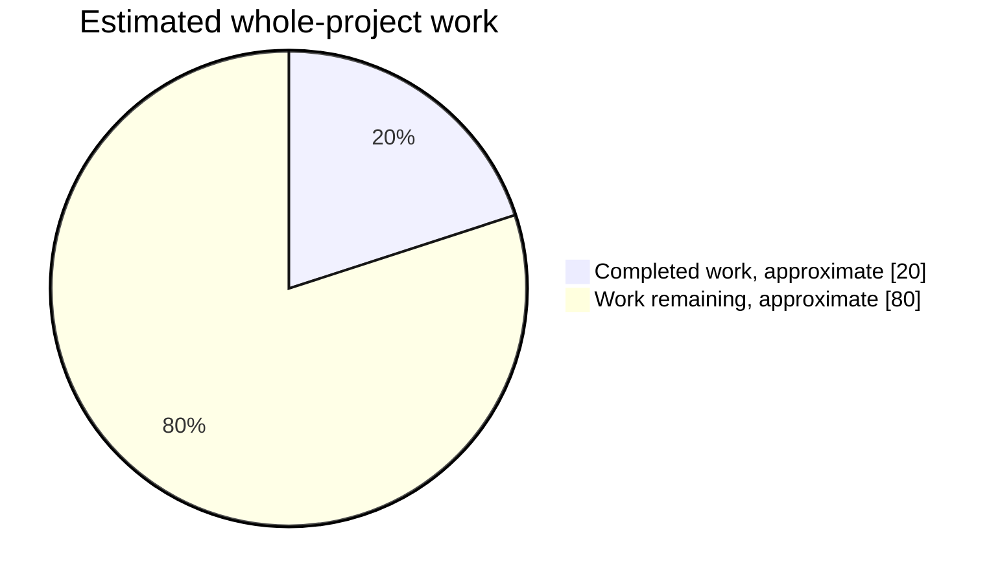

# Stunt Race FX

Stunt Race FX (aka Wild Trax) source reconstruction, reverse engineering, static recompilation, and ROMhacking project.

The primary goal of this repository is to reconstruct **Stunt Race FX** into a complete, buildable, original-style SNES source tree while preserving as much of the original Argonaut/Nintendo project structure and development style as reasonably possible. Further enhancements can be made once decomp is complete.

This repository also includes [sp00nznet's Stunt Race FX static recompilation project](https://github.com/sp00nznet/stuntrace), which approaches the game from a different direction and provides a valuable additional source of reverse-engineering information.

Once the original game has been sufficiently reconstructed, the long-term plan is to use that work as the basis for an **overclocked, FX3, and MSU-1 enhanced Stunt Race FX**, similar in spirit to the work done with [UltraStarFox](https://github.com/Sunlitspace542/ultrastarfox) and [UltraStarFox-OC](https://github.com/NachtRaveVL/ultrastarfox-oc).

Go [here](#building-original) to jump to the original-source building instructions.

---

## Project Tracks

This repository contains multiple approaches to understanding and rebuilding Stunt Race FX.

### `Original/` — Original-Style Source Reconstruction

This is the primary decompilation/reconstruction effort.

It begins with surviving early Stunt Race FX source material and attempts to reconstruct the missing and later portions of the game using the final retail ROM, disassembly, debugging, comparison against known source, and other reverse-engineering techniques.

This means retaining the original:

* 65C816 assembly source
* Super FX / GSU assembly source
* `.ASM`, `.MC`, `.INC`, and `.EXT` source organization
* Bank-oriented layout
* Makefile
* SASMX assembler workflow
* SL linker workflow
* Existing asset and data formats
* Existing file and directory layout wherever possible

### `StaticRecomp/` — Static Recompilation

This directory contains the static recompilation work by **[sp00nznet](https://github.com/sp00nznet)**.

### Future Efforts

Once decompilation is complete, planned enhancements include:

* Fully unlocked 21.4 MHz GSU clock (clock-halving disabled)
* 26–28 MHz overclocked GSU-1 support
* FX3 & MSU-1 support
* Additional ROMhacking and community-driven enhancements

---

## Reconstruction Progress

**Overall planning estimate: about 20% complete, about 80% left.** The section estimates below produce a **14-28% complete / 72-86% remaining** range. This is an engineering estimate of reconstruction and integration work, not a measured percentage of decompiled instructions. Confidence is low outside the camera and route work. It should be revised as the remaining banks are mapped.



### Subsystem Assessment

| Section | Weight | Estimated complete | Estimated left | Existing foundation and concrete remaining work |
| --- | ---: | ---: | ---: | --- |
| CPU platform, startup, NMI, display and object runtime | 10% | 10-25% | 75-90% | `XLSTART`, `XLIRQ`, `RAMSTUFF`, `XLMAIN`, `XLTRANS`, `STRATROU`: retail hardware initialization and selected callback helpers recovered; complete retail initialization chain, NMI modes, scheduler, object lifetime and display transitions still need reconciliation. Retail anchors: `$02:8000`, `$03:89B4`, `$03:D388`, `$0B:B479`. |
| Math, GSU rendering, clipping, sprites and effects | 15% | 15-35% | 65-85% | `MMATHS`, `MWROT`, `MWCROT`, `MOBJ`, `MCLIP`, `MDRAW*`, `MSPRITE`, `MDSPRITE`, `MPART`, `MDATA`: substantial early engine survives, with matching arithmetic and table spans; audit the rest of retail bank `$01`, material/draw paths, road rendering and the `$01:D12F` camera-flag consumer. |
| Vehicle dynamics, wheels, physics and collision | 20% | 5-15% | 85-95% | `MDYNAMIC`, `DYNSTRUC`, `DYNPARMS`, car strategies in `GASTRATS`: early cars/wheels/physics survive; list registration, definition-flag reads and approach rejection are restored, but final retail constructor/layout, all vehicle types, collision dispatch and frame integration remain. Retail anchors: `$04:8800`, `$04:8E59`, `$04:BCBA`, `$08:CC7C`. |
| Camera records, animation and camera strategies | 10% | 55-75% | 25-45% | `GAME`, `GASTRATS`, `WORLD`: largest concentration of reconstructed retail behavior; finish remaining scene/mode selection, animation-15 initialization, camera/owner teardown, sound and draw consumers, and all race/attract/split-screen contexts. Anchors: `$02:DAD6-$02:DF78`, `$08:8525-$08:9BD8`, `$09:8090`. |
| Route access, AI and driving controls | 10% | 35-55% | 45-65% | `MAI`, route helpers in `GASTRATS`, `WORLD`: normal driving, mode dispatch, slot timing, frozen-route motion and render-record allocation/recycling reconstructed; slot/flag producers, player binding, attached-render traversal and live AI scheduling remain. |
| Race rules, frontend, menus and game flow | 15% | 0-10% | 90-100% | `XLMAIN`, `XLTITLE`, `XLINIT`, `PSTRATS`, `GSTRATS`, `GASTRATS`, `ENDSEQ`: early behavior is a starting point; final race progression, timing/results, vehicle/course selection, attract/demo, two-player flow and endings need retail mapping and restoration. Anchors include `$0B:AE0A` and `$0B:FB26`. |
| Courses, scene streams, models, graphics and text | 15% | 5-15% | 85-95% | `MAPS`, shape sources, `MSPRITES`, `DATA`, `XLDATA`, `MDATA`, `SHBANKS`, `INCBINS`: inherited assets and some identical tables exist, but the built map includes an early fallback route, not the full retail course set. Restore final scene/course inventory, object placement, routes, model/texture/background differences and text, then validate references. |
| Audio driver, command mapping, music and samples | 5% | 0-10% | 90-100% | `XLSOUND`, `XLSND`, `SND`: early audio binaries survive and contain matching fragments; final driver/data organization, sound IDs, engine sound behavior, music/sample inventory and playback still need reconciliation. CPU audio anchors: `$04:D0DB`, `$04:D44C`, `$04:D649`, `$04:D720`. |

#### Retail Bank Map

| Retail bank(s) | Restored/adapted | Identical candidates | Uncredited | Mapped content or next investigation |
| --- | ---: | ---: | ---: | --- |
| `$00` | 514 | 6,682 | 25,572 | Verified sine-interpolation table; other shared-data candidates, reset/header and remaining content audit |
| `$01` | 765 | 1,953 | 30,050 | GSU math/render engine; verified inherited matrix and math spans, remaining draw pipeline |
| `$02` | 1,163 | 4,084 | 27,521 | CPU NMI/display and camera records; remaining runtime/control flow |
| `$03` | 483 | 1,407 | 30,878 | Hardware setup, matrix wrapper and callback/activity helpers; remaining CPU engine |
| `$04` | 4,035 | 262 | 28,471 | GSU dynamics/AI plus CPU audio routines; route modes, car/wheel poses and render-record lifecycle restored; constructor, attached-render traversal, physics and audio audit |
| `$05-$07` | 0 | 0 | 98,304 | Content/source correspondence still unclassified |
| `$08` | 3,878 | 65 | 28,825 | Camera/route helpers, map and object systems; remaining vehicle/gameplay logic |
| `$09` | 164 | 0 | 32,604 | Driving-camera presets; remaining scene/data and WRAM patch content |
| `$0A` | 0 | 0 | 32,768 | Content/source correspondence still unclassified |
| `$0B` | 0 | 0 | 32,768 | Known title/entity/game-frame entry points; original-source retail reconstruction still pending |
| `$0C` | 0 | 722 | 32,046 | Shape-data candidates; remaining content classification |
| `$0D-$13` | 0 | 0 | 229,376 | Content/source correspondence still unclassified |
| `$14` | 0 | 19,905 | 12,863 | `MDATA` wipe/Z-table/effect data candidates; validate table boundaries and consumers |
| `$15-$18` | 0 | 0 | 131,072 | Content/source correspondence still unclassified |
| `$19` | 0 | 844 | 31,924 | Fragments matching early `XLSND0.BIN`; remaining audio/data mapping |
| `$1A` | 0 | 1,713 | 31,055 | Fragments matching early `XLSND0.BIN`; remaining audio/data mapping |
| `$1B` | 0 | 396 | 32,372 | Fragments matching early `XLSND0.BIN`; remaining audio/data mapping |
| `$1C-$1F` | 0 | 0 | 131,072 | Content/source correspondence still unclassified |
| **All 32 banks** | **11,002** | **38,033** | **999,541** | **All 1 MiB accounted for exactly once** |

## Building Original

### Windows

Clone the repository:

```text
git clone https://github.com/NachtRaveVL/stuntracefx.git
cd stuntracefx
cd Original
```

To build:

```text
build.cmd
```

The build wrapper launches the original-style build process through DOSBox-X.

The build ultimately invokes the `Original/XL/MAKEFILE`, which currently uses:

```text
ASM=sasmx
LINK=SL
```

A successful build produces:

```text
Original/xl.sfc
```

---

## Contributing

Contributions are welcome.

For work under `Original/`, please keep changes consistent with the goals of the reconstruction:

* Preserve the existing source layout.
* Preserve original naming when known.
* Avoid unnecessary source reorganization.
* Avoid introducing replacement build systems when the existing one can be repaired or extended.
* Prefer implementations consistent with the surrounding original code.
* Clearly separate verified historical information from inferred reconstruction.
* Compare reconstructed behavior against the retail ROM where practical.
* Use findings from `StaticRecomp/` when they improve the accuracy of the reconstruction.
* Do not blindly translate static-recomp C back into assembly when the surrounding original source suggests a more appropriate implementation.

The project is attempting to reconstruct an **original or original-like source tree**, not merely produce another working implementation.

---

## Credits

### Original Game

**Stunt Race FX / Wild Trax** was developed by **Nintendo** and **Argonaut Software** for the Super Nintendo Entertainment System / Super Famicom.

The original programmers, artists, designers, musicians, and hardware engineers responsible for Stunt Race FX and the Super FX technology deserve credit for the game and the architecture being studied here.

### Repository / Reverse Engineering

* **NachtRaveVL / NR-RetroWorks** — Repository maintainer, original-source reconstruction, reverse engineering, build restoration, future enhancement work
* **sp00nznet** — Stunt Race FX static recompilation, reverse engineering, `snesrecomp` integration, Super FX / GSU work
* **UltraStarFox contributors** — Star Fox source preservation, tooling, ROMhacking work, and inspiration for the structure and future direction of the overclocking project
* **Nintendo / Argonaut Software developers** — Original Stunt Race FX source and game implementation

Additional contributors will be added as the project progresses.

---

## Helpful Links / Tools

[sp00nznet/stuntrace — Stunt Race FX Static Recompilation](https://github.com/sp00nznet/stuntrace)  
[sp00nznet/snesrecomp — SNES Static Recompilation Framework](https://github.com/sp00nznet/snesrecomp)  
[Sunlitspace542/ultrastarfox — UltraStarFox](https://github.com/Sunlitspace542/ultrastarfox)  
[Argonaut 65816/Super FX Assembly Extension for VS Code](https://github.com/Sunlitspace542/65816-superfx-asm-argonaut-vscode)  
[ArgSfx/SASM Assembler Documentation](https://github.com/Sunlitspace542/ArgSfx-SASM-Docs)  
[SNES Development Manual](https://archive.org/details/SNESDevManual)  
[fullsnes — SNES Hardware Specifications](https://problemkaputt.de/fullsnes.htm)  
[65C816 Opcodes](https://undisbeliever.net/snesdev/65816-opcodes.html)  
[65C816 Reference](https://wiki.superfamicom.org/65816-reference)  
[Super FX Programming Reference](https://en.wikibooks.org/wiki/Super_NES_Programming/Super_FX_tutorial)  

---

## Project Structure

```text
stuntracefx
├── Original
│   ├── XL
│   │   ├── DATA        Game data and graphics
│   │   ├── MAPS        Map / course source
│   │   ├── MSPRITES    Super FX sprite data
│   │   ├── SND         Music and sound data
│   │   ├── XLDATA      Additional game graphics/data
│   │   ├── XLSND       Sound data
│   │   ├── *.ASM       65C816 assembly source
│   │   ├── *.MC        Super FX / MARIO source
│   │   ├── *.INC       Include files and macros
│   │   ├── *.EXT       External symbol declarations
│   │   └── MAKEFILE    Original-style game build
│   ├── BLDSG.BAT       DOS build script
│   ├── BLDtotxt.BAT    Logged build script
│   ├── build.cmd       DOSBox-X build wrapper
│   └── dosbox.conf     DOSBox-X configuration
│
├── StaticRecomp
│   ├── ext             snesrecomp and dependencies
│   ├── include         Static recompilation headers
│   ├── src             Native recompilation source
│   ├── tools           Reverse-engineering tools
│   ├── CMakeLists.txt
│   └── README.md
│
├── Original-OC         Planned — not yet created
│
└── README.md
```

---

## License and Ownership

See [`LICENSE`](LICENSE) for licensing of repository-authored code.

Individual components and dependencies may carry their own licenses and copyright notices.

**Stunt Race FX**, **Wild Trax**, Super Nintendo, Super Famicom, and related game assets and intellectual property are the property of their respective rights holders.

This is an unofficial preservation, research, reverse-engineering, and ROMhacking project. It is not affiliated with, endorsed by, or sponsored by Nintendo, Argonaut Software, or their successors.
