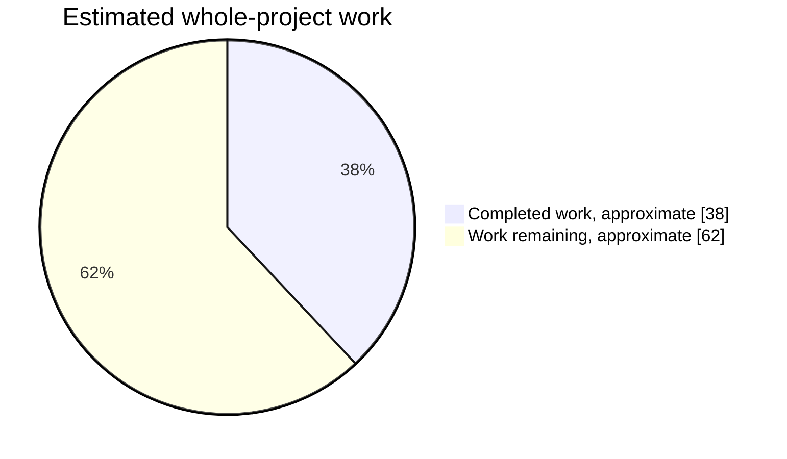
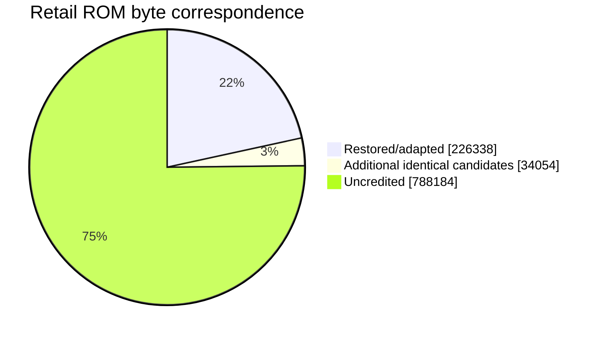

# Stunt Race FX

Stunt Race FX (aka Wild Trax) source reconstruction, reverse engineering, static recompilation, and ROMhacking project.

The primary goal of this repository is to reconstruct **Stunt Race FX** into a complete, buildable, original-style SNES source tree while preserving as much of the original Argonaut/Nintendo project structure and development style as reasonably possible. Further enhancements can be made once decomp is complete.

This repository also includes [sp00nznet's Stunt Race FX static recompilation project](https://github.com/sp00nznet/stuntrace), which approaches the game from a different direction and provides a valuable additional source of reverse-engineering information.

Once the original game has been sufficiently reconstructed, the long-term plan is to use that work as the basis for an **overclocked, FX3, and MSU-1 enhanced Stunt Race FX**, similar in spirit to the work done with [UltraStarFox](https://github.com/Sunlitspace542/ultrastarfox) and [UltraStarFox-OC](https://github.com/NachtRaveVL/ultrastarfox-oc).

Go [here](#building-original) to jump to the original-source building instructions.

---

## Project Tracks

This repository contains multiple approaches to understanding and rebuilding Stunt Race FX.

### `Original/` — Original-Style Source Reconstruction

This is the primary decompilation/reconstruction effort.

It begins with surviving early Stunt Race FX source material and attempts to reconstruct the missing and later portions of the game using the final retail ROM, disassembly, debugging, comparison against known source, and other reverse-engineering techniques.

This means retaining the original:

* 65C816 assembly source
* Super FX / GSU assembly source
* `.ASM`, `.MC`, `.INC`, and `.EXT` source organization
* Bank-oriented layout
* Makefile
* SASMX assembler workflow
* SL linker workflow
* Existing asset and data formats
* Existing file and directory layout wherever possible

### `StaticRecomp/` — Static Recompilation

This directory contains the static recompilation work by **[sp00nznet](https://github.com/sp00nznet)**.

### Future Efforts

Once decompilation is complete, planned enhancements include:

* Fully unlocked 21.4 MHz GSU clock (clock-halving disabled)
* 26–28 MHz overclocked GSU-1 support
* FX3 & MSU-1 support
* Additional ROMhacking and community-driven enhancements

---

## Reconstruction Progress

**Overall planning estimate: about 38% complete, about 62% left.** This is the rounded weighted midpoint of the section estimates below; their bounds give approximately **30-47% complete / 53-70% remaining**. It estimates reconstruction and integration effort, not a measured percentage of decompiled instructions. Confidence remains low for the unclassified runtime, game-flow and asset work and should be revised as those banks are mapped.



### Subsystem Assessment

| Section | Weight | Estimated complete | Estimated left | Existing foundation and concrete remaining work |
| --- | ---: | ---: | ---: | --- |
| CPU platform, startup, NMI, display and object runtime | 10% | 30-45% | 55-70% | `XLSTART`, `XLIRQ`, `RAMSTUFF`, `MRCPU`, `MRSCENE`, `MRHUD`, `MRDISP`, `MRBLANK`, `XLMAIN`, `XLTRANS`, `STRATROU`: hardware initialization, synchronous GSU submission, raw object construction/binding, contact queries, actor pool lifetime, spatial ownership and bound-pool reset restored. Retail text/number output, diagnostics, PPU setup/clear, tilemaps, reverse-order register/VRAM queues, bitmap strip transfers, OAM/CGRAM publication, brightness, window/HDMA setup and packed-tile upload entries are callable. Frame acknowledgement, blanking, profiling/status producers, GSU ownership and resource binding remain caller-owned; the early NMI is unchanged. The early arena holds 140 actors versus retail’s 310; full capacity, complete initialization, NMI modes, scheduler and display transitions remain. Anchors: `$02:8000`, `$02:BF1C`, `$03:89B4`, `$08:CB98`. |
| Math, GSU rendering, clipping, sprites and effects | 15% | 20-45% | 55-80% | `MMATHS`, `MWROT`, `MWCROT`, `MOBJ`, `MCLIP`, `MDRAW*`, `MSPRITE`, `MDSPRITE`, `MPART`, `MDATA`: substantial early engine survives, with matching arithmetic and table spans. `MRDISP` restores retail single/group sprite clipping, high-table packing and stale-sprite clearing; `MRFRONT` adds fixed-point motion, sprite cloning, animation stepping and hardware-multiplier palette scaling. Audit the rest of retail bank `$01`, material/draw paths, road rendering and the `$01:D12F` camera-flag consumer. |
| Vehicle dynamics, wheels, physics and collision | 20% | 45-65% | 35-55% | `MDYNAMIC`, `MRCAR`, `MRFORCE`, `MRCOLL`, `MRWHEEL`, `MRHEAP`, `MRUPDATE`, `MRCPU`, `MRSCENE`, `MRPRESNT`, `MRCARFX`, `MRLIFE`, `RCARDEFS`: raw object/vehicle frames, CPU controls, wheels, auxiliary/eye actors, four vehicle breakup families, fragment launch/return, collision feedback, sound-state transitions and debris restored. Player/opponent/attract lifecycles, car lists, ranked grid placement, single/two-player input producers, boost recovery/repair callers and lift/finish actor transitions restored. Both bound raw heaps can be coalesced through the CPU task entry. CPU submission preserves polygon context and invalidates decoded points. Retail heap/shape binding, remaining car/game-flow consumers, renderer scheduling and game-frame integration remain. Anchors: `$04:8800`, `$04:8CC6`, `$08:A034`, `$08:C124`. |
| Camera records, animation and camera strategies | 10% | 65-85% | 15-35% | `GAME`, `GASTRATS`, `WORLD`, `MRLIFE`, `MRVIEWS`: early and raw-car camera interfaces coexist. Raw velocity/route fields, animation, road/intro/hold/driving, drift/end/braking shots, preset sound requests and player finish handoffs restored. Contact shake, first-grid target selection, close/fixed/low-chase shots, animation-15 initialization, free/reset transitions and preview cameras restored. Remaining mode selection, teardown, draw consumers and full race/attract/split-screen integration need restoration. Anchors: `$02:DAD6-$02:DF78`, `$08:8525-$08:9BD8`, `$09:8090`. |
| Route access, AI and driving controls | 10% | 35-55% | 45-65% | `MAI`, `MRCPU`, `MRLIFE`, route helpers in `GASTRATS`, `WORLD`: normal driving, mode dispatch, lap/rank producers, player timing, frozen-route motion, CPU button/edge gates and inactivity handling reconstructed; car owner lifetime and input producers are restored, while remaining scene mode producers, multiplayer flow and live AI scheduling remain. |
| Race rules, frontend, menus and game flow | 15% | 5-15% | 85-95% | `MRMENU` restores input capture/navigation, record names/times/ranks, vehicle indicators, window transitions and 20 record-display definitions; bank-9 bridges connect their callbacks to the restored entity dispatcher. Entity construction preserves the native 88-byte copy and its spill, including rebinding the final-slot spill to the register queue. `MRVIEWS` restores vehicle-preview actors and the selection camera. Record snapshots, cursor output, packed scene graphics and sound/frame ownership remain caller-bound. `XLMAIN`, `XLTITLE`, `XLINIT`, `PSTRATS`, `GSTRATS`, `GASTRATS`, `ENDSEQ` remain an early foundation; final race progression, timing/results producers, remaining menu/course selection, attract/demo, two-player flow and endings need restoration and integration. Anchors include `$0B:AE0A` and `$0B:FB26`. |
| Courses, scene streams, models, graphics and text | 15% | 10-20% | 80-90% | `MAPS`, shape sources, `MSPRITES`, `DATA`, `XLDATA`, `MDATA`, `SHBANKS`, `INCBINS`: inherited assets and some identical tables exist. `MRDISP`/`MRPALS` restore 17 full RGB555 palettes (16 referenced by the restored catalogue), 22 shared color ramps, palette expansion/change masks and OAM layouts. `MRFORMS` restores all 100 frontend sprite forms, 85 animation sequences (114 frames) and 129 bytes of HDMA recipes with rebound indirect pointers. Their tile graphics and scene loaders remain unbound; the built map still uses an early fallback route. The retail scene-command reader, four-car grid records, camera commands, bounds extraction, mode filters and breakable/rotating props are restored in `MRVIEWS`, requiring compiled callbacks and caller-bound assets. Restore final scene/course inventory, object placement, routes, model/texture/background differences and text, then validate references. |
| Audio driver, command mapping, music and samples | 5% | 50-65% | 35-50% | `XLSOUND`, `XLSLOAD`, `XLRACE`, `XLSPC*`, `SPCMACS`, `CRUMACS`, `MAI`, `MDECRU`: both SPC cores, all identified scene/sample uploads and 20 songs have assembly correspondence, including 16 byte-exact packed streams. The split-screen loader, vehicle-kind selection, CPU queues and parameter producers match both live SPC profiles. Three additional songs have confirmed bank-separated callers. Remaining work includes final ROM placement, startup/game-frame/NMI scheduling, definition ownership/callers and intended callers for the extra sample and three songs; the early SPC path is still active. |

#### Retail Bank Map

| Retail bank(s) | Restored/adapted | Identical candidates | Uncredited | Mapped content or next investigation |
| --- | ---: | ---: | ---: | --- |
| `$00` | 3,606 | 5,683 | 23,479 | Fatal diagnostics/HDMA, compact bitmap font, verified byte/interpolated sine tables and full arctangent read window; remaining reset/header, shared-data and content audit |
| `$01` | 1,258 | 1,775 | 29,735 | GSU math/render engine; verified inherited matrix, math and backward-decompression spans, remaining draw pipeline |
| `$02` | 1,391 | 4,084 | 27,293 | CPU NMI/display, camera records, synchronous GSU launcher/RNG and audio port service; remaining runtime/control flow and SPC integration |
| `$03` | 6,211 | 1,018 | 25,539 | CPU actor lifetime, rotations/easing, hardware setup, text/number output, PPU setup/clear, DMA descriptors, tilemaps, palette catalogues, display-cost helpers and packed-tile decode/upload entries; remaining CPU engine, scene resource bindings and scheduling |
| `$04` | 20,116 | 3 | 12,649 | GSU dynamics/AI and CPU audio: raw construction/teardown, release/coalescing tasks, vehicle/object callbacks, route modes/ranks, wheel/body collision and audio helpers restored; remaining initialization/task wrappers, CPU ownership and integration |
| `$05-$06` | 0 | 0 | 65,536 | Content/source correspondence still unclassified |
| `$07` | 80 | 0 | 32,688 | Nearby-car CPU audio consumer; remaining content/source correspondence audit |
| `$08` | 31,148 | 1 | 1,619 | Camera/route helpers, player/opponent lifetime, grids/input, repair/recovery callers, lift/finish transitions, vehicle/auxiliary strategies, breakup, collision feedback, scene commands, preview actors, free/reset cameras and trackside effects, timing/car/wheel/cell diagnostics and error displays; remaining attachment helper and tail data, asset binding and scheduling |
| `$09` | 2,875 | 0 | 29,893 | Camera presets, nine vehicle definitions and all 16 typed visual descriptors with source callbacks; remaining scene/data and WRAM patch content |
| `$0A` | 0 | 0 | 32,768 | Content/source correspondence still unclassified |
| `$0B` | 17,273 | 3 | 15,492 | Engine audio parameters/curves, 22-slot 2D entities, native default-copy and record-group constructors, sprite forms/animation, record-display definitions and callbacks, menu input/navigation, palette scaling, display queues/publication, bitmap strips and window/HDMA restored; remaining menu definitions/strategies, scene resource binding, game-frame and audio integration |
| `$0C` | 0 | 722 | 32,046 | Shape-data candidates; remaining content classification |
| `$0D-$13` | 0 | 0 | 229,376 | Content/source correspondence still unclassified |
| `$14` | 0 | 19,905 | 12,863 | `MDATA` wipe/Z-table/effect data candidates; validate table boundaries and consumers |
| `$15-$18` | 0 | 0 | 131,072 | Content/source correspondence still unclassified |
| `$19` | 32,672 | 90 | 6 | Initial SPC and first-player instrument payloads restored; native IPL headers excluded from credit, final placement remains |
| `$1A` | 32,736 | 28 | 4 | Initial BRR, second-player samples and split-screen SPC core head restored; native IPL headers and final placement remain |
| `$1B` | 26,604 | 140 | 6,024 | Split-screen core tail and all identified instrument/sample uploads restored; IPL headers, 6,020-byte tail padding, extra sample's caller and final placement remain |
| `$1C` | 0 | 256 | 32,512 | Content/source correspondence still unclassified |
| `$1D` | 8,264 | 0 | 24,504 | Eight packed song streams reconstructed; remaining prefix content, padding, intended callers and final placement |
| `$1E` | 30,861 | 32 | 1,875 | Four raw and eight packed songs reconstructed; all song content represented. Physical credit counts raw payloads and packed streams once; decoded sizes are not added again. Raw IPL headers, padding and final placement remain outside restoration credit |
| `$1F` | 11,243 | 314 | 21,211 | 17 full RGB555 palettes, 22 shared ramps and three ramp-length schemes restored; one full palette has no bound catalogue caller. Remaining content, display resource integration and padding audit |
| **All 32 banks** | **226,338** | **34,054** | **788,184** | **All 1 MiB accounted for exactly once** |

The GSU dynamics/AI window `$04:8800-$04:D03F` has verified correspondence for **18,238 of 18,496 bytes (98.61%)**, leaving **258 bytes not yet credited**. This covers that kernel and its tables; CPU callers, asset binding and game integration are assessed separately above.

**Measured ROM correspondence: 21.59% restored/adapted, 78.41% not yet credited.** This includes assets; identical candidates receive no restoration credit.



## Building Original

### Windows

Clone the repository:

```text
git clone https://github.com/NachtRaveVL/stuntracefx.git
cd stuntracefx
cd Original
```

To build:

```text
build.cmd
```

The build wrapper launches the original-style build process through DOSBox-X.

The build ultimately invokes the `Original/XL/MAKEFILE`, which currently uses:

```text
ASM=sasmx
LINK=SL
```

A successful build produces:

```text
Original/xl.sfc
```

---

## Contributing

Contributions are welcome.

For work under `Original/`, please keep changes consistent with the goals of the reconstruction:

* Preserve the existing source layout.
* Preserve original naming when known.
* Avoid unnecessary source reorganization.
* Avoid introducing replacement build systems when the existing one can be repaired or extended.
* Prefer implementations consistent with the surrounding original code.
* Clearly separate verified historical information from inferred reconstruction.
* Compare reconstructed behavior against the retail ROM where practical.
* Use findings from `StaticRecomp/` when they improve the accuracy of the reconstruction.
* Do not blindly translate static-recomp C back into assembly when the surrounding original source suggests a more appropriate implementation.

The project is attempting to reconstruct an **original or original-like source tree**, not merely produce another working implementation.

---

## Credits

### Original Game

**Stunt Race FX / Wild Trax** was developed by **Nintendo** and **Argonaut Software** for the Super Nintendo Entertainment System / Super Famicom.

The original programmers, artists, designers, musicians, and hardware engineers responsible for Stunt Race FX and the Super FX technology deserve credit for the game and the architecture being studied here.

### Repository / Reverse Engineering

* **NachtRaveVL / NR-RetroWorks** — Repository maintainer, original-source reconstruction, reverse engineering, build restoration, future enhancement work
* **sp00nznet** — Stunt Race FX static recompilation, reverse engineering, `snesrecomp` integration, Super FX / GSU work
* **UltraStarFox contributors** — Star Fox source preservation, tooling, ROMhacking work, and inspiration for the structure and future direction of the overclocking project
* **Nintendo / Argonaut Software developers** — Original Stunt Race FX source and game implementation

Additional contributors will be added as the project progresses.

---

## Helpful Links / Tools

[sp00nznet/stuntrace — Stunt Race FX Static Recompilation](https://github.com/sp00nznet/stuntrace)  
[sp00nznet/snesrecomp — SNES Static Recompilation Framework](https://github.com/sp00nznet/snesrecomp)  
[Sunlitspace542/ultrastarfox — UltraStarFox](https://github.com/Sunlitspace542/ultrastarfox)  
[Argonaut 65816/Super FX Assembly Extension for VS Code](https://github.com/Sunlitspace542/65816-superfx-asm-argonaut-vscode)  
[ArgSfx/SASM Assembler Documentation](https://github.com/Sunlitspace542/ArgSfx-SASM-Docs)  
[SNES Development Manual](https://archive.org/details/SNESDevManual)  
[fullsnes — SNES Hardware Specifications](https://problemkaputt.de/fullsnes.htm)  
[65C816 Opcodes](https://undisbeliever.net/snesdev/65816-opcodes.html)  
[65C816 Reference](https://wiki.superfamicom.org/65816-reference)  
[Super FX Programming Reference](https://en.wikibooks.org/wiki/Super_NES_Programming/Super_FX_tutorial)  

---

## Project Structure

```text
stuntracefx
├── Original
│   ├── XL
│   │   ├── DATA        Game data and graphics
│   │   ├── MAPS        Map / course source
│   │   ├── MSPRITES    Super FX sprite data
│   │   ├── SND         Music and sound data
│   │   ├── XLDATA      Additional game graphics/data
│   │   ├── XLSND       Sound data
│   │   ├── *.ASM       65C816 assembly source
│   │   ├── *.MC        Super FX / MARIO source
│   │   ├── *.INC       Include files and macros
│   │   ├── *.EXT       External symbol declarations
│   │   └── MAKEFILE    Original-style game build
│   ├── BLDSG.BAT       DOS build script
│   ├── BLDtotxt.BAT    Logged build script
│   ├── build.cmd       DOSBox-X build wrapper
│   └── dosbox.conf     DOSBox-X configuration
│
├── StaticRecomp
│   ├── ext             snesrecomp and dependencies
│   ├── include         Static recompilation headers
│   ├── src             Native recompilation source
│   ├── tools           Reverse-engineering tools
│   ├── CMakeLists.txt
│   └── README.md
│
├── Original-OC         Planned — not yet created
│
└── README.md
```

---

## License and Ownership

See [`LICENSE`](LICENSE) for licensing of repository-authored code.

Individual components and dependencies may carry their own licenses and copyright notices.

**Stunt Race FX**, **Wild Trax**, Super Nintendo, Super Famicom, and related game assets and intellectual property are the property of their respective rights holders.

This is an unofficial preservation, research, reverse-engineering, and ROMhacking project. It is not affiliated with, endorsed by, or sponsored by Nintendo, Argonaut Software, or their successors.
